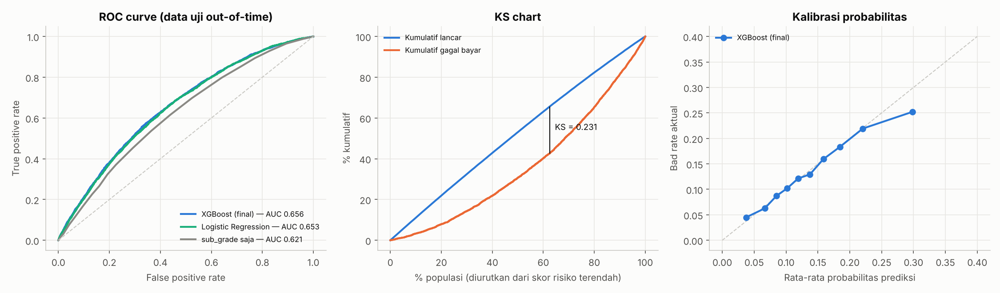
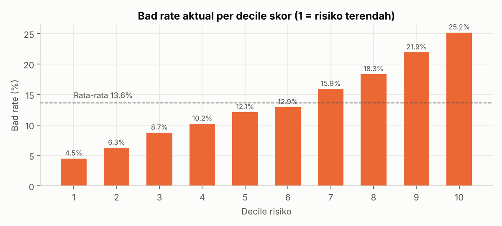
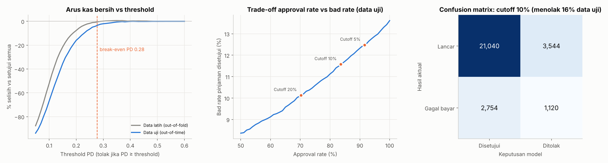
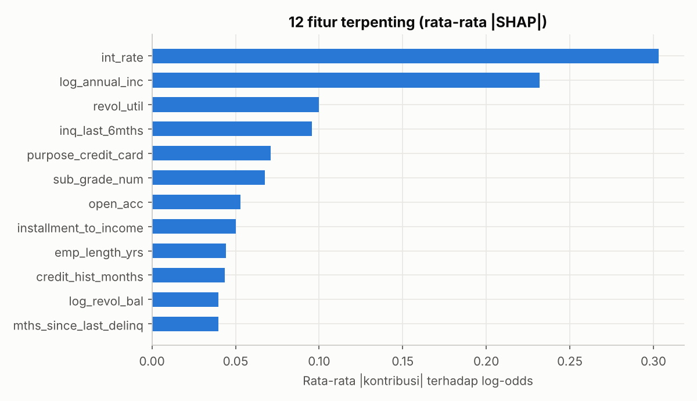

# Implementation of Prediction Model for Credit Risk

[Final task] Data Scientist project-based internship ID/X Partners x Rakamin Academy. **Versi 2: revisi metodologi.**

> **Ringkasan revisi.** Versi pertama project ini melaporkan akurasi 99,3%. Setelah diaudit, angka itu ternyata berasal dari
> *data leakage*: ada fitur yang baru tercatat setelah pinjaman macet, SMOTE dijalankan sebelum train-test split, dan pinjaman
> yang belum selesai dilabeli "tidak berisiko". Versi 2 membuktikan sumber kebocoran tersebut, membangun ulang pipeline dengan benar,
> dan mengevaluasi model dengan metrik serta sudut pandang bisnis yang lazim di credit scoring.
> Hasilnya ROC-AUC **0,656** pada data out-of-time. Angka ini jauh lebih rendah, tetapi jujur.
>
> **Dashboard interaktif:** https://credit-risk-model-implementation-khirana.streamlit.app/

---

## Latar Belakang
ID/X Partners (berdiri 2002) adalah konsultan *data analytics and decisioning* untuk industri jasa keuangan, telekomunikasi, manufaktur, dan ritel di Asia dan Australia.
Dalam project ini, klien (perusahaan pemberi pinjaman) ingin meningkatkan ketepatan penilaian risiko kredit agar keputusan pemberian pinjaman lebih baik dan potensi kerugian berkurang.
Tugasnya adalah membangun model *machine learning* yang memprediksi risiko gagal bayar dari data pinjaman Lending Club 2007–2014 (466.285 baris, 75 kolom).

## Audit Versi 1: dari mana akurasi 99% berasal?

| # | Masalah di versi 1 | Perbaikan di versi 2 |
|---|---|---|
| 1 | SMOTE dijalankan **sebelum** train-test split, sehingga data uji berisi sampel sintetis | Split dulu. SMOTE (jika dipakai) hanya di data latih, di dalam pipeline |
| 2 | Fitur pasca-pencairan ikut dipakai (`recoveries`, `total_rec_prncp`, `out_prncp`, `total_pymnt`, `last_pymnt_amnt`, dll.) | Hanya fitur yang diketahui saat pengajuan |
| 3 | Target encoding dihitung dari seluruh data, termasuk data uji | One-hot encoding di dalam pipeline |
| 4 | Status `Current` (±48% data, hasil akhir belum diketahui) dilabeli "tidak berisiko" | Hanya pinjaman 36 bulan yang sudah jatuh tempo |
| 5 | `id`, `member_id`, `Unnamed: 0` menjadi fitur | Dibuang |
| 6 | `fillna(0)` pada `mths_since_last_delinq`, sehingga "tidak pernah menunggak" terbaca "baru menunggak" | Flag + nilai batas 120 bulan |
| 7 | Evaluasi dengan akurasi pada data seimbang hasil SMOTE | ROC-AUC, Gini, KS, PR-AUC, kalibrasi, analisis threshold |

Contoh paling jelas: `recoveries` (uang yang ditagih **setelah** pinjaman dihapusbukukan) bernilai > 0 pada 56% pinjaman Charged Off dan **0%** pada semua status lain.

**Eksperimen ablation**: model sama (XGBoost), kesalahan diperbaiki satu per satu.

| Skenario | Data uji | Accuracy | Recall (berisiko) | ROC-AUC |
|---|---|---|---|---|
| A. Pipeline versi 1 | sintetis (SMOTE) | 0,993 | 0,986 | 0,999 |
| B. + SMOTE setelah split | asli | 0,988 | 0,896 | 0,995 |
| C. + tanpa fitur pasca-pencairan | asli | 0,889 | 0,004 | 0,691 |

Kesimpulan ablation: penyumbang kebocoran terbesar adalah **fitur pasca-pencairan**, bukan hanya SMOTE.
Akurasi 0,889 pada skenario C hanya setara dengan menebak "semua tidak berisiko", sehingga akurasi bukan metrik yang tepat untuk kasus ini.

## Metodologi Versi 2

1. **Target:** pinjaman tenor 36 bulan yang dicairkan Jun-2007 s/d Des-2012 dan sudah jatuh tempo per snapshot data (Jan-2016).
   `1` = Charged Off / Default / Late 31–120 hari, `0` = Fully Paid. Total **72.521 pinjaman**, bad rate **12,6%**.
2. **Fitur:** hanya yang tersedia saat pengajuan, yaitu data pengajuan (jumlah, suku bunga, sub-grade, tujuan, pendapatan, DTI, masa kerja) dan riwayat biro kredit
   (inquiry, utilisasi kredit bergulir, tunggakan, catatan publik, panjang riwayat kredit), ditambah rasio turunan seperti `loan_to_income` dan `installment_to_income`.
3. **Split out-of-time:** train = dicairkan sebelum Jul-2012 (44.063 pinjaman), test = Jul–Des 2012 (28.458 pinjaman).
4. **Pipeline:** imputasi, scaling, one-hot encoding, dan SMOTE ada di dalam `Pipeline`, sehingga di setiap fold cross-validation semuanya hanya belajar dari data latih.
5. **Seleksi model:** 5-fold cross-validation pada data latih untuk 7 kandidat (Logistic Regression, Random Forest, XGBoost, masing-masing dengan/tanpa class weight atau SMOTE).
6. **Evaluasi akhir** pada data uji out-of-time, dilakukan sekali.

## Hasil

**Cross-validation (data latih)**

| Model | ROC-AUC | PR-AUC | Brier score |
|---|---|---|---|
| **XGBoost** (terpilih) | **0,679** | **0,218** | **0,101** |
| XGBoost + scale_pos_weight | 0,677 | 0,217 | 0,215 |
| Random Forest | 0,673 | 0,213 | 0,101 |
| Logistic Regression | 0,673 | 0,214 | 0,101 |
| Logistic Regression + SMOTE | 0,668 | 0,209 | 0,228 |
| XGBoost + SMOTE | 0,666 | 0,205 | 0,103 |

SMOTE dan class weight **tidak menaikkan** ROC-AUC dan justru merusak kalibrasi probabilitas (Brier score memburuk). Karena itu, ketidakseimbangan kelas ditangani lewat pemilihan threshold.

**Data uji out-of-time**

| Model | ROC-AUC | Gini | KS | PR-AUC |
|---|---|---|---|---|
| **XGBoost (final)** | **0,656** | **0,312** | **0,231** | **0,217** |
| Logistic Regression | 0,653 | 0,305 | 0,227 | 0,213 |
| Baseline: `sub_grade` saja | 0,621 | 0,242 | 0,177 | 0,186 |



Model memisahkan risiko dengan jelas: bad rate decile skor tertinggi **25,2%**, sedangkan decile terendah **4,5%**.



## Dampak Bisnis

| Kebijakan (data uji) | Approval rate | Bad rate disetujui | Gagal bayar tertolak | Arus kas bersih |
|---|---|---|---|---|
| Setujui semua | 100% | 13,6% | 0% | USD 35,8 jt |
| Profit-optimal (PD < 0,35) | 98,6% | 13,4% | 3,2% | USD 35,6 jt (−0,6%) |
| Cutoff 10% (dari data latih) | 83,6% | 11,6% | 28,9% | USD 31,1 jt (−13,1%) |
| Cutoff 20% (dari data latih) | 70,2% | 10,1% | 47,7% | USD 26,5 jt (−26,0%) |



- Pinjaman di data ini **sudah disetujui dan sudah diberi harga sesuai risiko** oleh Lending Club. Pinjaman baru merugi jika PD-nya di atas **0,28**,
  dan hanya ±6% pengajuan yang melewati batas itu. Karena itu, aturan tolak berbasis profit hampir tidak mengubah arus kas.
- Model bisa **menekan bad rate** sesuai risk appetite (13,6% → 11,6%), dengan biaya volume dan pendapatan bunga yang hilang.
- Cutoff dari persentil data latih menolak ±16% (bukan 10%) di data uji, karena skor bergeser naik. Ini alasan model perlu dimonitor, misalnya dengan PSI.
- Nilai utama model ini adalah **estimasi PD yang terkalibrasi** untuk pricing, expected loss, dan pengendalian risk appetite.

## Fitur Terpenting (SHAP)


Fitur terpenting kini masuk akal secara bisnis: suku bunga, pendapatan tahunan, utilisasi kredit bergulir, jumlah inquiry kredit 6 bulan terakhir,
dan tujuan pinjaman. Bandingkan dengan versi 1, yang fitur terpentingnya `recoveries`.

## Dashboard Streamlit
**Coba langsung:** https://credit-risk-model-implementation-khirana.streamlit.app/

Folder `app/` berisi dashboard interaktif berbahasa Indonesia dengan empat halaman:

- **Kalkulator Risiko**: isi data pengajuan, lalu dashboard menampilkan probabilitas gagal bayar, kategori risiko, dan faktor pendorongnya (SHAP per peminjam).
- **Simulasi Threshold**: geser threshold dan lihat dampaknya pada approval rate, bad rate, recall, dan arus kas bersih.
- **Ringkasan Model**: metrik out-of-time, cerita audit leakage (99% → 0,656), bad rate per decile, dan fitur terpenting.
- **Kamus Fitur**: deskripsi setiap fitur berdasarkan data dictionary Lending Club, cara pengolahannya, dan kolom yang tidak dipakai beserta alasannya.

Dashboard tidak membutuhkan dataset mentah. Skor data uji sudah diringkas di `app/data/` oleh `app/prepare_app_data.py`.

## Keterbatasan
- **Bias seleksi:** data hanya berisi pinjaman yang disetujui, sehingga perlu *reject inference* untuk dipakai pada seluruh pemohon.
- **Cakupan:** tenor 36 bulan, 2007–2012. Populasi sudah bergeser di periode uji (bad rate 12,0% → 13,6%).
- **Perhitungan bisnis disederhanakan:** tanpa diskonto, biaya dana, dan biaya operasional.

## Struktur Folder
    ├── data/
    │   ├── LCDataDictionary.csv
    │   └── loan_data_2007_2014.csv            # tidak di-commit (±240 MB), unduh terpisah
    ├── outputs/
    │   ├── *.png                               # grafik versi 1
    │   └── v2/                                 # grafik, metrik, dan model versi 2
    │       ├── credit_risk_model_v2.joblib     # pipeline final + threshold
    │       └── metrics_v2.json
    ├── src code/
    │   ├── Final_Task_IDX_Partners_Data_Scientist_KhiranaDwicahyo.ipynb   # versi 1 (arsip)
    │   └── credit_risk_model_v2.ipynb                                     # versi 2
    ├── app/
    │   ├── streamlit_app.py                    # dashboard
    │   ├── features.py                         # transformasi fitur (identik dengan notebook)
    │   ├── prepare_app_data.py                 # membuat data ringkas untuk dashboard
    │   ├── data/                               # skor data uji & ringkasan model
    │   └── requirements.txt                    # dependensi dashboard (versi dikunci)
    ├── .streamlit/config.toml
    ├── requirements.txt                        # dependensi notebook
    └── README.md

## Cara Menjalankan
```bash
pip install -r requirements.txt
# letakkan loan_data_2007_2014.csv di folder data/
cd "src code"
jupyter notebook credit_risk_model_v2.ipynb
```
Notebook berjalan ±3 menit (2 CPU) dan akan membuat ulang semua isi `outputs/v2/`.

Menjalankan dashboard secara lokal:
```bash
pip install -r app/requirements.txt
streamlit run app/streamlit_app.py
```

---
Khirana Dwicahyo. Versi 1: 5 Februari 2025. Versi 2 (revisi metodologi): Oktober 2026.
